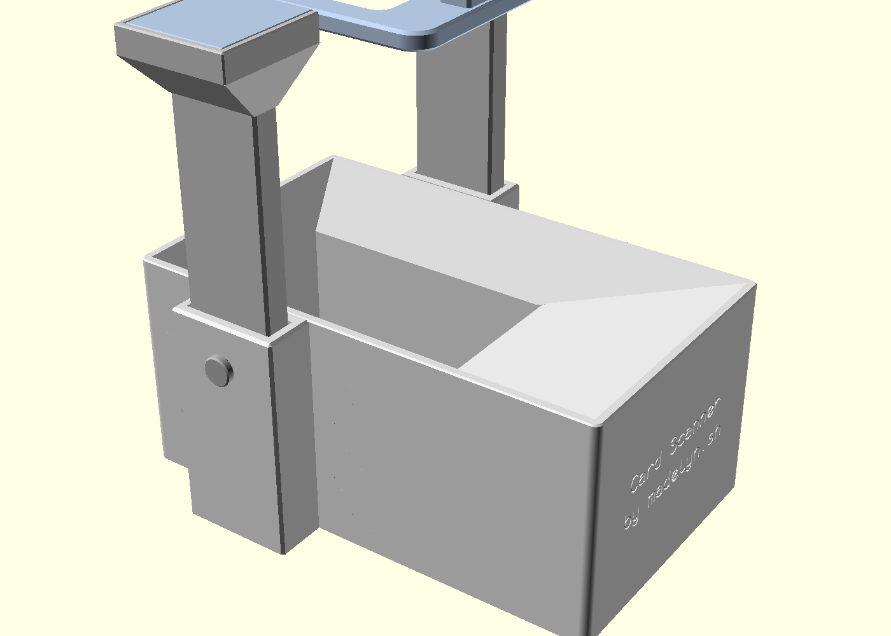

# Card Scanner

A 3D-printed stand for scanning trading cards with a phone. Toss a card into
the box, it slides down a ramp into a pocket, and a phone resting on the plate
above photographs it. Card-scanning apps that read the camera in real time can
log a stack of cards this way without you touching the phone.



The model is one OpenSCAD file, `card-scanner.scad`, built with the
[BOSL2](https://github.com/BelfryScad/BOSL2) library. Every dimension is a
Customizer parameter. The label on the entry end uses the
[Monofur](https://www.dafont.com/monofur.font) font; install it, or set
`label_font` to a font you have, or OpenSCAD falls back to its default.

## Parts

| Part | Print | Notes |
|---|---|---|
| Base | 1, as modeled | Funnel box with a card pocket, honeycomb underside, hex light windows, a socket on each long wall, and an engraved label on the entry end |
| Pillar | 2, pad down (`print_pillar`) | Plain post with a row of pin holes and a square cradle on top |
| Pin | 2 plus a spare | Cross-pin that sets the pillar height. An M4 bolt fits the same hole |
| Plate | 1, flat | Phone rests here. Tongues drop into the cradles. Has the camera hole and the LED mount |

Every part fits a 180 × 180 mm bed.

## Printing

PLA works well. Print the base in white or natural filament so light reaches
the card; the other parts can be any color.

- 0.2 mm layers, 3 walls, 4 top and bottom layers, 10 % infill.
- No supports. Holes and windows are shaped to print without them.
- A 5 mm brim on the pillars.

## Assembly

1. Drop a pillar into each socket, holes facing out, and push a pin through
   the boss into the hole for the height you want. The lowest hole gives the
   highest plate.
2. Set the plate on the two cradles, tongues inside the walls.
3. Optional light: push a 5 mm LED up through the hole under the block on the
   plate, bend the legs apart, and drop a CR2032 coin cell between them. Pull
   the cell to switch off.
4. Lay the phone on the plate with its camera over the hole.

Seed the pocket with a few spare cards before scanning so the first card has
a short drop.

## Customizing

Open the file in OpenSCAD and use the Customizer, or pass values on the
command line. The most useful parameters:

- `sleeved`: size the pocket for sleeved or bare cards.
- `card_w`, `card_l`: card size. Defaults are for standard trading cards.
- `bed`: your printer's bed. The file warns if a part will not fit.
- `pin_holes`, `pin_pitch`: number and spacing of height positions.
- `led_mount`: include or omit the LED block.
- `wall_windows`, `honeycomb`: turn the light windows and the hollow
  underside on or off.
- `label`, `label_line1`, `label_line2`: the engraved text.

## Exporting

`scripts/export.sh` writes a 3MF for each part into `export/`, with the
pillar already pad-down:

```sh
scripts/export.sh              # all parts
scripts/export.sh out plate    # one part into a chosen directory
```

It looks for `openscad` on your PATH, then in the usual install locations.
Set `OPENSCAD` to the binary path to override.

## License

[CC BY-NC 4.0](LICENSE.md). Print, modify, and share it. Do not sell it.
